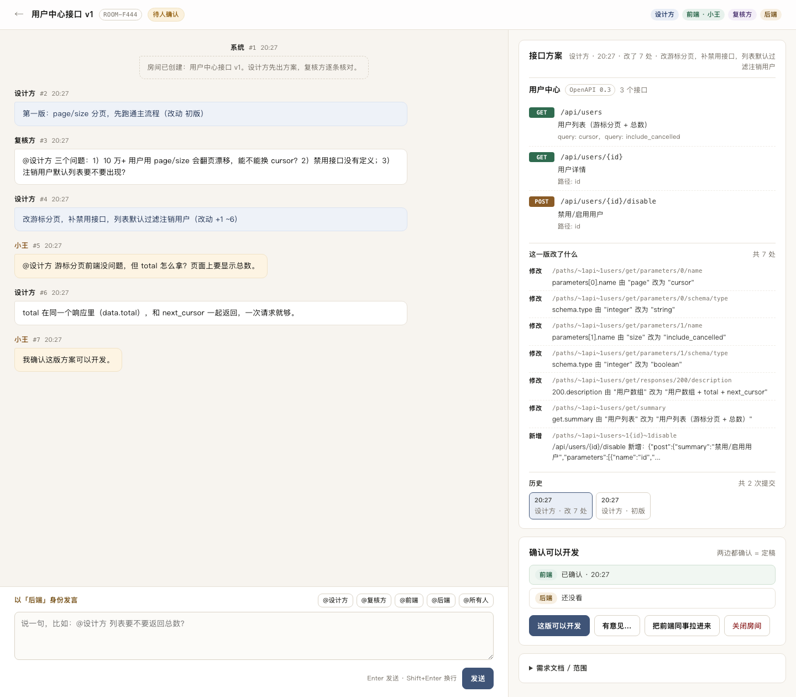

# AI 圆桌 · 0.4

最新开发交接：[本地 Agent 自动执行的现状与下一步（2026-10-27）](docs/superpowers/specs/2026-10-27-handoff-local-agent-orchestration.md)。新对话接续开发请先读此文。 当前 V1 已部署内网并推送 GitHub；下一阶段待办是让服务器网页通过本地连接器调用成员电脑上的项目与 Codex/DSH，连接器尚未实现。

新版首页已支持上传需求文档、API 模型与外部 MCP Agent、出方案→审查→修订→定稿。

```bash
pnpm install
pnpm dev                      # 默认 http://localhost:3000；PORT 可更改端口
```

在页面添加 Agent、加入房间、上传需求后点「出方案」。外部 Agent 使用新版 `/rt-mcp`，通过 Bearer token 接入，可按需读取项目代码和记忆文件。连接后需在外部客户端主动要求它处理待办。

连接步骤、工具、工作区范围和产物目录见 [外部 Agent 使用说明](docs/roundtable-mcp.md)。

部署到服务器见 [部署说明](docs/deployment.md)。Docker 使用独立数据目录，数据库和模型 Key 不进入镜像或 Git。

## 以下为旧版 0.2 参考

旧版界面保留在 `/legacy`，使用旧 `/mcp` 与房间入场券。下面的角色、工具和命令属于旧版；新版以使用说明为准。



前后端接口由两个 AI 先对齐，人最后点头。

- **两个 AI 在房间里对话**：一个出接口方案，一个挑问题，一来一回改到双方都认可。
- **接口方案取代"契约"这个词**：每次提交只展示"改了几处、改在哪"；没有版本号，历史按时间列。
- **人只做一次决定**：把前端同事拉进来，前后端各看一眼，点「这版可以开发」，房间状态变成"可以开发"，两边开始写代码。

## 快速开始

```bash
pnpm install
pnpm dev                      # http://localhost:3000
```

1. 打开首页，填标题（可选填需求文档），选"设计方是谁"（DeepSeek 还是 Codex），点「建房，生成三张入场券」。
2. 复制两张 **agent 票**，分别配给两个 agent。
3. 两个 agent 各自「进房间」开始对方案。
4. 方案稳定后，在房间页点「把前端同事拉进来」，把链接发给前端。
5. 前端、后端各点一次「这版可以开发」，状态变成 **可以开发**。

## 把 agent 接进来

Codex：

```bash
export NEG_TOKEN=<设计方或复核方的票>
codex mcp add room-a --url http://<你的IP>:3000/mcp --bearer-token-env-var NEG_TOKEN
```

DeepSeek（DSH / 支持 URL 的 MCP 客户端）：

```
http://<你的IP>:3000/mcp?token=<票>
```

每张票绑定「哪个房间 + 哪个角色」，不需要其它参数。agent 进房间后拿到带 `my_todos` 和 `next_hint` 的 bootstrap，被 `@` 时待办里会出现 `reply_human`。

## agent 看到的工具

| 工具 | 作用 |
|---|---|
| `join_room` | 进房间，拿到需求文档、当前接口方案、历史发言、`my_todos` 和 `next_hint` |
| `get_messages` | 拉新发言，支持长等待（≤30s）；没有新消息时最多等一次 |
| `send_message` | 发言，`@设计方` / `@复核方` / `@前端` / `@后端` / `@所有人` |
| `submit_plan` | 设计方提交接口方案（OpenAPI 3.x），返回相对上一版改了哪几处 |
| `get_plan` | 读当前方案或某次提交；`history=true` 返回历次提交的时间与改动数量 |

## 房间状态

| 状态 | 含义 |
|---|---|
| 设计中 | 两个 AI 还在对方案 |
| 待人确认 | 方案已提交，人还没看 / 只看了一边 |
| 可以开发 | 前后端都确认了这版 |
| 已关闭 | 不再收发言 |

新方案提交后，之前的确认自动作废（显示"上次确认的是旧方案"）。

## 常用命令

```bash
pnpm demo        # 内存里跑一遍完整流程，打印时间线
pnpm test        # 17 个测试：@ 解析、待办、长等待、确认失效、MCP 全链路
pnpm admin create-room --title "用户中心接口" --scope "用户列表 详情 禁用" --prd-file docs/x.md --designer A
pnpm admin rooms
pnpm admin invite --token <后端票> --side frontend --name 小王
pnpm admin confirm --token <后端票> --ok
```

## 约定与限制

- 接口方案只认 OpenAPI 3.x；提交上限 1MB；差异按 JSON Pointer 给出（`+` 新增、`-` 删除、`~` 修改）。
- 同一时刻只有 **设计方** 能提交方案；复核方只提意见，人只做确认。
- 入场券是唯一的身份：token 丢了就是只读。不登录，方便局域网里拉人。
- 只有人在能点确认；agent 没有"确认可以开发"的工具，这是有意的。
- `answer.md`、旧「契约」文档已归档在 `docs/superpowers/specs/`，以 `2026-10-23-api-negotiation-room-min-design.md` 为准。

## 文件结构

```
src/
  domain/     @ 解析、待办、提示、状态、OpenAPI 校验、diff
  service/    房间服务：建房、进房、发言、提交方案、确认
  mcp/        5 个工具
  http/       网页 API + 静态页
  web/        原生 HTML/JS 网页（无构建）
  db/         内置 node:sqlite
tests/        17 个测试
scripts/      demo 脚本
```
